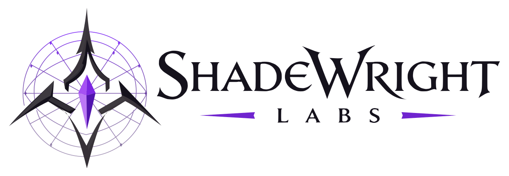

<h1 align="center">
  <picture>
    <source media="(prefers-color-scheme: dark)" srcset="docs/assets/brand/shadewright-labs-dark.svg">
    
  </picture>
  <br>
  Armory
</h1>

<p align="center">
  <em>The armory is the room of the house where the wrights keep the pieces every one of them needs: the veil that hides what must not be read, the gauge that checks a piece before it leaves the bench, and the chain that records who did what.</em>
</p>

<p align="center">
  Shared Go building blocks for Shadewright Labs products: redaction, hygiene checks and tamper-evident audit chains. Every product may depend on it, and it depends on none of them.
</p>

<p align="center">
  <a href="https://github.com/shadewright-labs/armory/actions/workflows/ci.yml?query=branch%3Amain"></a>
  <a href="https://pkg.go.dev/github.com/shadewright-labs/armory"></a>
  <a href="go.mod"></a>
  <a href="https://codecov.io/gh/shadewright-labs/armory"></a>
  <a href="LICENSE"></a>
  <a href="https://scorecard.dev/viewer/?uri=github.com/shadewright-labs/armory"></a>
</p>

> [!WARNING]
> Armory has no release yet, and its API can change until v1.0.0. Redaction is the next package. Follow the work in [Shadewright issue #1132](https://github.com/shadewright-labs/shadewright/issues/1132).

## What it holds

| Package | What it is for | State |
| --- | --- | --- |
| [`modelusage`](modelusage) | Reading the token usage a model provider reports in a reply (Anthropic Messages, OpenAI chat completions and Responses), complete or streamed, within byte limits the caller sets, with cache, reasoning, compaction and advisor tokens counted once | Available |
| [`netguard`](netguard) | Deciding whether an IP address is a public unicast address a product may dial, from the IANA special-purpose registries with a date, and refusing other addresses in a `net.Dialer` `Control` hook | Available |
| Redaction | Hiding known secret forms in text from outside a product, in bounded time, before the text reaches a model, storage, logs or a person | Planned, next |
| Hygiene checks | Checks a repository runs before publishing: emails, local paths and key-shaped literals in tracked files | Planned |
| Audit chain | Chained audit records, so that an edit, a removed row or a truncated tail is detected | Planned |

These are the parts of the [six shared security laws](https://shadewrightlabs.com/#security-laws) that more than one product needs. Each product keeps its own policy, approvals, tokens and model clients.

## Use it

Import path: `github.com/shadewright-labs/armory/modelusage`.

There is no tagged version yet, so `go get` needs `@main` or a commit hash, and the API can change until v1.0.0:

```bash
go get github.com/shadewright-labs/armory@main
```

```go
const reply = `{
	"id": "msg_01",
	"type": "message",
	"role": "assistant",
	"usage": {
		"input_tokens": 50,
		"cache_creation_input_tokens": 240,
		"cache_read_input_tokens": 1800,
		"output_tokens": 120
	}
}`
lim := modelusage.Limits{MaxBytes: 1 << 20, MaxTokens: 1 << 30}
u, err := modelusage.ParseJSON(modelusage.Anthropic, strings.NewReader(reply), lim)
if err != nil {
	fmt.Println("error:", err)
	return
}
fmt.Printf("prompt=%d uncached=%d output=%d total=%d\n",
	u.TotalInputTokens(), u.UncachedInputTokens(), u.OutputTokens, u.TotalTokens())
```

More runnable examples are in [modelusage/example_test.go](modelusage/example_test.go). They will also show on [pkg.go.dev](https://pkg.go.dev/github.com/shadewright-labs/armory/modelusage) once the first version is tagged.

## Repositories

| Repository | Contents |
| --- | --- |
| [armory](https://github.com/shadewright-labs/armory) | This module |
| [shadewright](https://github.com/shadewright-labs/shadewright) | The Kubernetes remediation operator |
| [sablecourt](https://github.com/shadewright-labs/sablecourt) | The control plane for coding agents and deterministic controllers (nothing released yet) |
| [shadewright-labs.github.io](https://github.com/shadewright-labs/shadewright-labs.github.io) | Website repository. Website: [shadewrightlabs.com](https://shadewrightlabs.com) |

## Development

Run these before asking for review:

```bash
go build ./...
go vet ./...
go test -race -count=1 ./...
golangci-lint run ./...
govulncheck ./...
actionlint && zizmor .github/workflows    # for workflow changes
```

A change to a parser also runs its fuzz targets for a while, for example `go test ./modelusage -run '^$' -fuzz '^FuzzParseStream$' -fuzztime 30s`.

CI runs the same Go checks on pull requests, plus gosec, CodeQL, a short fuzz run of every target, a secret scan of the full history and the tests of its own scripts, and ends in one job, `ci-ok`. Every fuzz target also runs for four minutes each week. CI uploads the coverage profile to Codecov, which reports coverage and never fails a check. [docs/ci.md](docs/ci.md) describes each workflow.

Contributor guide: [CONTRIBUTING.md](CONTRIBUTING.md). Coding-agent guide: [AGENTS.md](AGENTS.md). To report a vulnerability privately, follow the [security policy](SECURITY.md).

## The name

An *armory* is where a house keeps the gear its people share. This one holds the code the products share, so that a secret form hidden in one product is hidden the same way in the next.

## License

Apache License 2.0, see [LICENSE](LICENSE).
